# ALU+ CHAMO

### Diseño, verificación e implementación física de una ALU síncrona de 16 bits

**SystemVerilog · Synopsys Design Compiler · Synopsys IC Compiler II · Verificación RTL · ASIC Physical Design · SKY130HD**

Proyecto de ingeniería digital que documenta el desarrollo de una unidad aritmético-lógica desde su descripción RTL hasta las etapas de síntesis e implementación física.

https://youtu.be/s-iQtVW1CrM
---

## 1. Descripción del proyecto

**ALU+ CHAMO** es un proyecto de diseño digital enfocado en desarrollar y verificar una unidad aritmético-lógica (ALU) de 16 bits mediante SystemVerilog.

El objetivo consiste en demostrar cómo un circuito descrito a nivel RTL puede verificarse funcionalmente, sintetizarse y transformarse en una implementación física mediante herramientas de diseño ASIC.

La arquitectura incluye un sumador **Carry-Lookahead Adder (CLA)**, un divisor combinacional de tipo *restoring*, operaciones lógicas, generación de banderas y una interfaz síncrona con registros de entrada y salida.

El proyecto también contiene módulos independientes que permiten estudiar el comportamiento de buses triestado.

Se documentan dos entornos de implementación distintos:

- **Synopsys:** síntesis lógica mediante Design Compiler e implementación física mediante IC Compiler II.
- **OpenROAD / SKY130HD:** implementación anterior del proyecto, de la cual se conserva un archivo GDSII público.

Ambas implementaciones se identifican por separado. El GDSII de SKY130HD no corresponde al checkpoint final generado en ICC2.

---

## 2. Arquitectura digital

### 2.1 Organización general

La arquitectura utiliza un núcleo combinacional y una envoltura síncrona de 16 bits.

El núcleo recibe dos operandos, un código de operación y produce el resultado junto con las banderas correspondientes.

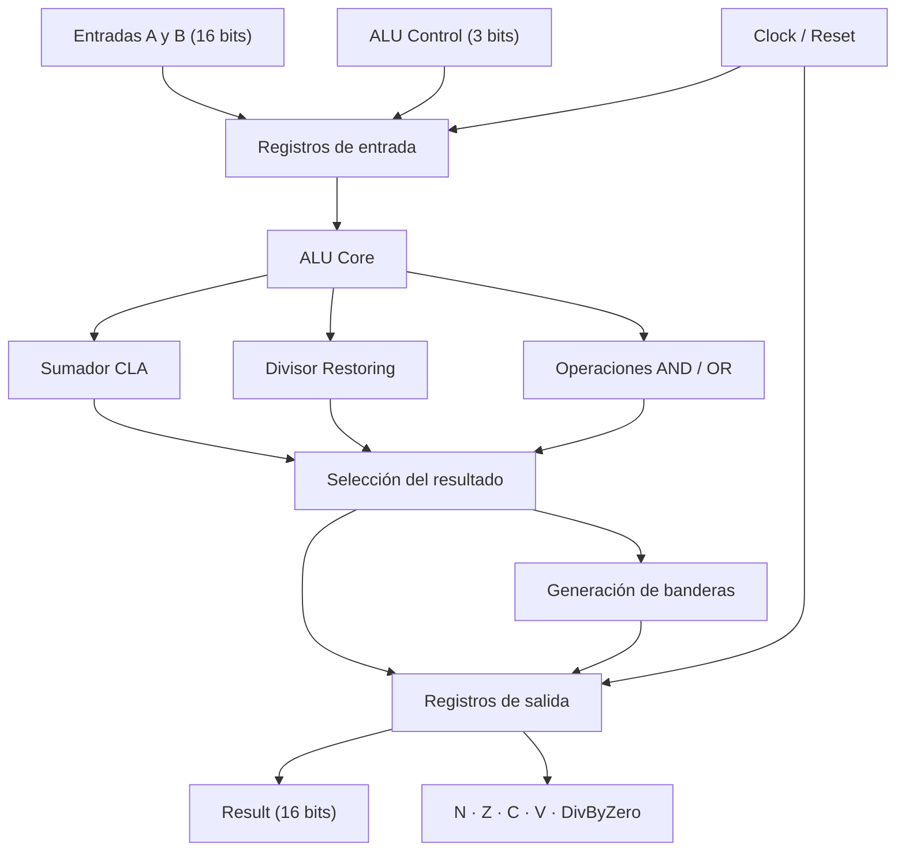

**Figura 1.** Diagrama conceptual de los bloques funcionales de ALU+ CHAMO.

### 2.2 Módulos RTL

| Archivo                 | Descripción                                                             |
| ----------------------- | ----------------------------------------------------------------------- |
| `alu_cla.sv`            | Sumador por anticipación de acarreo organizado en grupos de cuatro bits |
| `alu_divider.sv`        | Divisor combinacional sin signo, con cálculo de cociente y residuo      |
| `alu_core.sv`           | Núcleo principal y selección de operaciones                             |
| `alu_sync16.sv`         | Interfaz síncrona de 16 bits con registros                              |
| `alu_logic_tristate.sv` | Demostración de AND/OR con aislamiento de operandos y bus triestado     |
| `alu_tristate_demo.sv`  | Demostración independiente de conductores triestado                     |

Los módulos principales forman una jerarquía que permite separar las operaciones aritméticas de la lógica de control.

### 2.3 Operaciones implementadas

| ALU Control | Operación | Descripción             |
| :---------: | --------- | ----------------------- |
|    `000`    | ADD       | Suma aritmética         |
|    `001`    | SUB       | Resta aritmética        |
|    `010`    | AND       | Operación AND bit a bit |
|    `011`    | OR        | Operación OR bit a bit  |
|    `100`    | ZERO      | Salida igual a cero     |
|    `101`    | DIV       | Cociente de división    |
|    `110`    | MOD       | Residuo de división     |
|    `111`    | ZERO      | Salida igual a cero     |

La división se interpreta como una operación **sin signo**. Cuando el divisor es cero, el núcleo devuelve cero y activa la bandera correspondiente.

### 2.4 Banderas de estado

| Bandera     | Función                                                  |
| ----------- | -------------------------------------------------------- |
| `N`         | Indica que el bit más significativo del resultado es uno |
| `Z`         | Se activa cuando el resultado es cero                    |
| `C`         | Carry de suma o carry-out de la resta                    |
| `V`         | Overflow aritmético con interpretación de signo          |
| `DivByZero` | Detecta división o módulo entre cero                     |

En una resta, `C` representa el carry-out de la operación en complemento a dos, no directamente una bandera de préstamo.

---

## 3. Fundamento del diseño aritmético

### 3.1 Carry-Lookahead Adder (CLA)

El sumador utiliza señales de propagación y generación de acarreo.

Para cada posición:

[
P_i=A_i\oplus B_i
]

[
G_i=A_iB_i
]

El acarreo se obtiene mediante:

[
C\_{i+1}=G_i+P_iC_i
]

La suma resulta:

[
S_i=P_i\oplus C_i
]

La implementación organiza el cálculo en grupos de cuatro bits. Dentro de cada grupo se anticipan los acarreos mediante expresiones combinacionales.

El carry de salida de un grupo alimenta al siguiente, por lo que la arquitectura se puede describir como un **CLA agrupado de cuatro bits**.

La resta aprovecha el mismo sumador mediante complemento a dos:

[
A-B=A+\overline{B}+1
]

Esto evita implementar una unidad completamente independiente para la resta.

### 3.2 Divisor tipo Restoring

El divisor realiza una división binaria sin signo mediante desplazamientos, comparaciones y restas sucesivas.

Durante cada iteración:

1. Se incorpora un bit del dividendo al residuo parcial.
2. Se compara el residuo parcial con el divisor.
3. Si el residuo parcial es suficiente, se resta el divisor.
4. Se establece el bit correspondiente del cociente.
5. Se continúa hasta procesar todos los bits.

La relación matemática es:

[
A=BQ+R
]

donde:

- (A): dividendo.
- (B): divisor.
- (Q): cociente.
- (R): residuo.

Para un divisor distinto de cero:

[
0\le R\<B
]

El RTL implementa todas las iteraciones mediante lógica combinacional, no mediante una máquina de estados de múltiples ciclos.

Esto simplifica la interfaz funcional, aunque puede producir trayectorias combinacionales largas durante la síntesis física.

### 3.3 Arquitectura síncrona

El módulo `alu_sync16` incorpora registros para los operandos, el código de operación y las salidas.

Los operandos se capturan en un flanco positivo de reloj y el resultado correspondiente se registra en el siguiente flanco positivo.

El reset es **asíncrono y activo en bajo**, inicializando registros y banderas.

---

## 4. Verificación funcional

La verificación se organiza mediante seis testbenches escritos en SystemVerilog.

Se utilizan casos dirigidos, vectores pseudoaleatorios y una comprobación exhaustiva para los módulos aritméticos de ocho bits.

### 4.1 Organización de pruebas

| Testbench              | Objetivo                                          | Casos programados |
| ---------------------- | ------------------------------------------------- | ----------------: |
| `tb_alu_arithmetic.sv` | Validar CLA y divisor                             |             2,010 |
| `tb_alu_core.sv`       | Validar las ocho operaciones de la ALU            |            24,048 |
| `tb_alu_sync16.sv`     | Comprobar sincronización y resultados registrados |             4,041 |
| `tb_alu_tristate.sv`   | Verificar Z, conducción y conflicto de señales    |                 5 |
| `tb_exhaustive8.sv`    | Recorrer operandos de ocho bits y carry-in        |           131,072 |
| `tb_logic_tristate.sv` | Comprobar selección AND/OR y alta impedancia      |                 8 |
| **Total**              | **Casos definidos en los testbenches**            |       **161,184** |

Los números corresponden a los casos programados en el código fuente. No deben interpretarse como una certificación de que todos se ejecutaron exitosamente en una misma campaña.

En el testbench síncrono, la última operación cuenta como estímulo, pero su resultado final requiere una comprobación adicional para cerrar completamente la secuencia.

### 4.2 Gráfica de casos programados

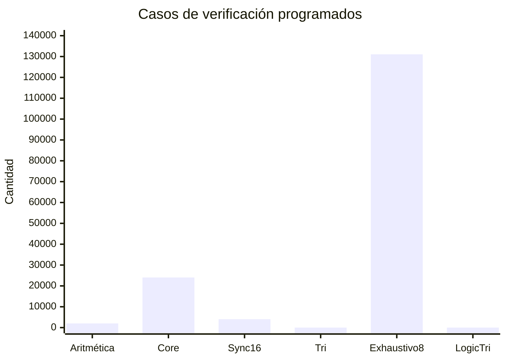

**Figura 2.** Cantidad de casos definida por los seis testbenches. La prueba exhaustiva de ocho bits representa la mayor parte de los estímulos.

### 4.3 Simulación de división y módulo

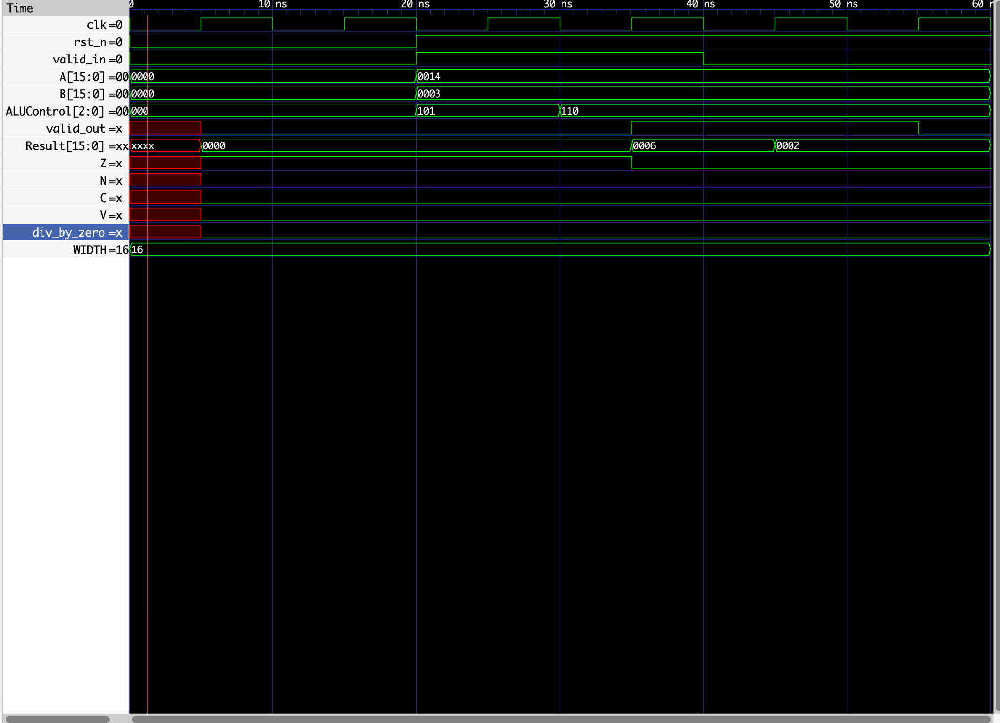


**Figura 3.** Captura de simulación funcional utilizada para observar operandos, señales de control y resultados de las operaciones DIV y MOD.

La verificación de división es importante porque comprueba operaciones que requieren más lógica combinacional que las funciones AND y OR.

### 4.4 Simulación de buses triestado

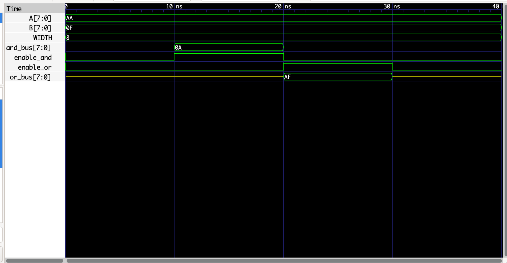


**Figura 4.** Comportamiento de las señales triestado y estados de alta impedancia durante la simulación.

Los módulos triestado son demostraciones RTL independientes. **No forman parte de la jerarquía física instanciada por `alu_sync16`.**

En el núcleo sintetizable, las operaciones AND y OR emplean aislamiento de operandos y selección combinacional.

---

## 5. Síntesis lógica

La implementación con Synopsys utiliza **Design Compiler** para transformar la descripción RTL en una representación estructural basada en celdas estándar.

La síntesis permite analizar la lógica combinacional y secuencial, optimizar estructuras y generar una netlist tecnológica para el diseño físico.

Entre los elementos sintetizados se encuentran:

- Sumador CLA agrupado.
- Red combinacional del divisor.
- Lógica AND y OR.
- Multiplexores de selección de operación.
- Registros de operandos y salidas.
- Lógica de banderas y control.

La cantidad exacta de celdas y el área dependen de la biblioteca y de las restricciones utilizadas.

Los reportes tecnológicos originales del entorno académico no se incluyen en este repositorio.

---

## 6. Implementación física ASIC

Después de la síntesis se realizó la implementación física mediante **Synopsys IC Compiler II (ICC2)**.

El flujo comprende la planificación del área, distribución de alimentación, colocación de celdas, construcción del árbol de reloj y enrutamiento de señales.

### 6.1 Flujo de implementación

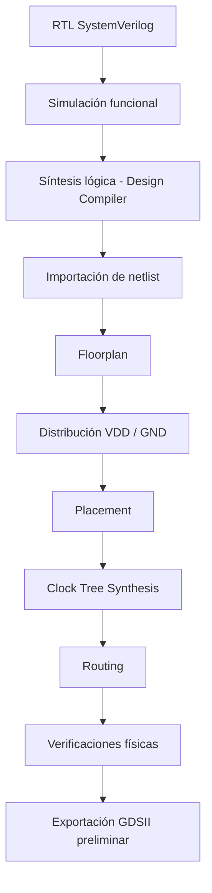

**Figura 5.** Secuencia de trabajo de la implementación Synopsys. La ejecución de las etapas no implica por sí sola aprobación de signoff.

### 6.2 Floorplan

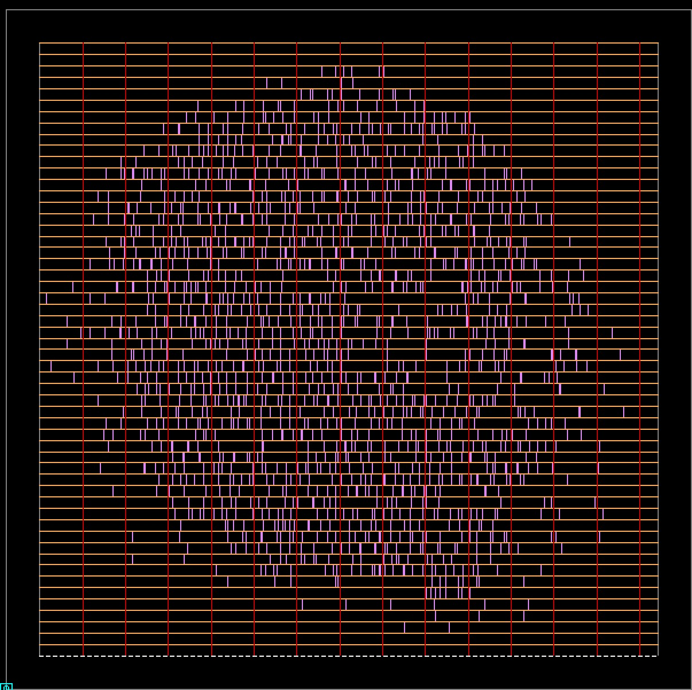


**Figura 6.** Vista física del diseño dentro de IC Compiler II. Se observa la región de implementación y la distribución general de las estructuras físicas.

El floorplan establece la organización espacial del circuito y sirve de referencia para la colocación e interconexión posterior de las celdas.

### 6.3 Distribución de alimentación

Durante la implementación se construyeron las conexiones de alimentación VDD y GND.

La validación de conectividad del checkpoint corregido mostró:

| Verificación                      | Resultado |
| --------------------------------- | --------: |
| Celdas estándar flotantes en VDD  |         0 |
| Celdas estándar flotantes en GND  |         0 |
| Verificación después de placement |     0 / 0 |
| Verificación después de CTS       |     0 / 0 |
| Verificación después de routing   |     0 / 0 |

Los resultados anteriores verifican conectividad PG según el comprobador utilizado. No constituyen por sí solos una verificación completa de integridad de potencia, electromigración o IR drop.

### 6.4 Placement

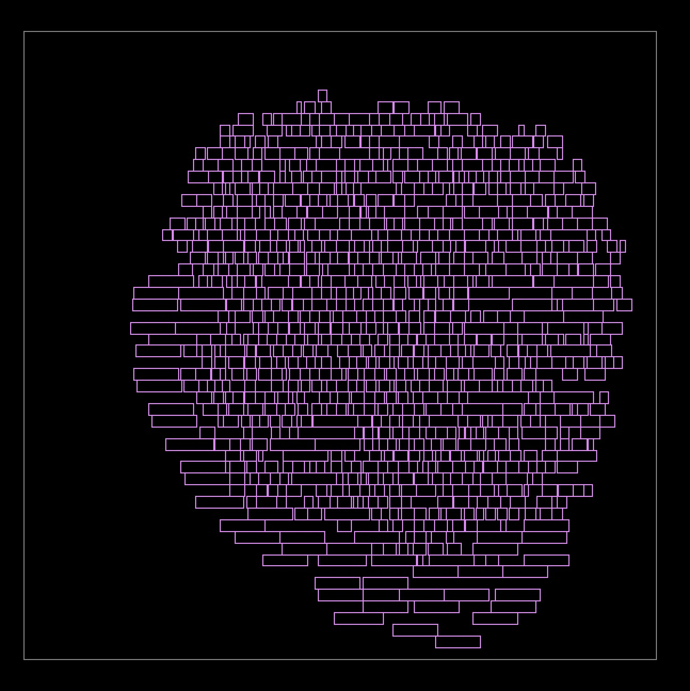


**Figura 7.** Distribución física de celdas estándar dentro del núcleo del diseño.

La etapa de placement determina la ubicación de las instancias para cumplir restricciones físicas y temporales.

Después de la optimización de placement se registraron **910 celdas** y ninguna celda sin colocar.

### 6.5 Clock Tree Synthesis (CTS)

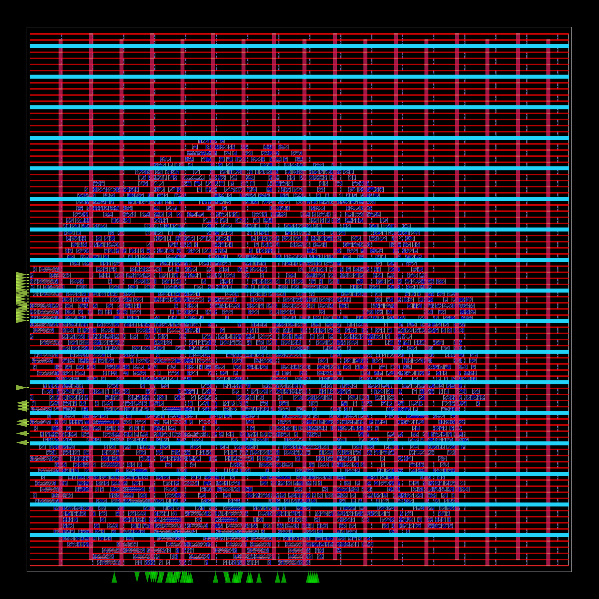


**Figura 8.** Estado físico capturado durante la documentación del flujo de reloj en ICC2. La imagen representa la disposición general del diseño y no un análisis aislado de las ramas de reloj.

La etapa de CTS permite implementar y optimizar la distribución del reloj hacia los registros secuenciales.

Después de esta etapa se registraron **943 celdas**, sin instancias pendientes de colocación.

### 6.6 Routing

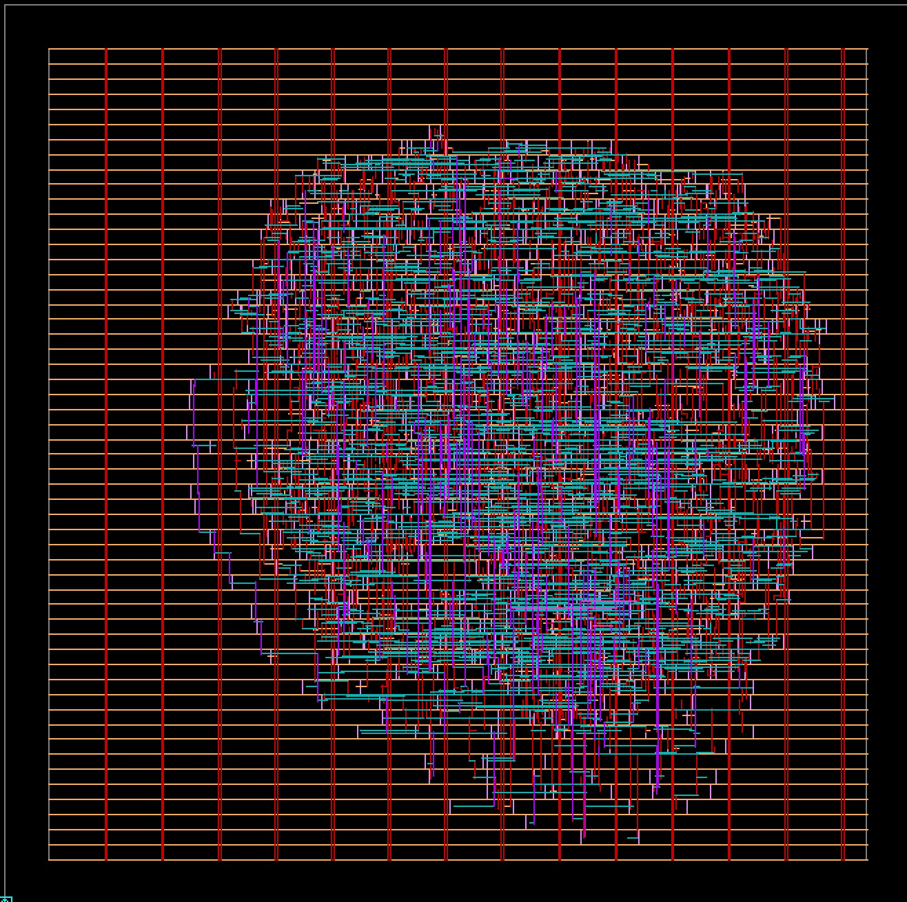


**Figura 9.** Vista del diseño físico con estructuras de interconexión visibles después de las etapas de routing.

Durante routing se construyen las conexiones metálicas necesarias entre las celdas y los puertos del circuito.

En la implementación Synopsys se ejecutaron las etapas de enrutamiento automático y optimización posterior.

El reporte producido contiene un valor de **125** en el campo de violaciones analizado. Su clasificación y resolución requieren revisar el reporte detallado; por ello no se declara routing libre de violaciones.

---

## 7. Evolución física del diseño

Los registros del flujo permiten observar cómo cambia el número de instancias durante la implementación.

| Etapa observada                  | Celdas registradas |
| -------------------------------- | -----------------: |
| Checkpoint inicial de referencia |                911 |
| Después de placement             |                910 |
| Después de CTS                   |                943 |
| Después del flujo físico final   |                943 |

### 7.1 Gráfica de evolución de celdas

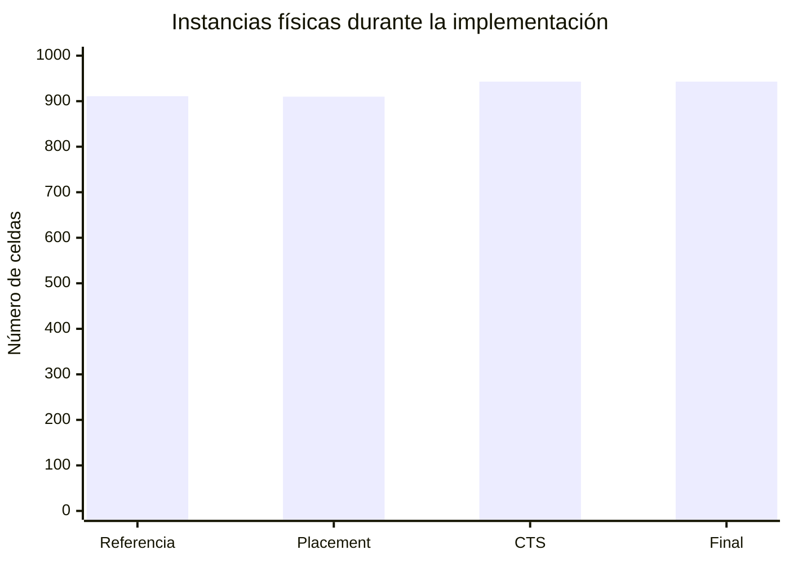

**Figura 10.** Recuento de instancias obtenido en los puntos documentados del flujo ICC2.

Las diferencias pueden estar asociadas a optimizaciones, eliminación o sustitución de instancias e inserción de elementos necesarios para implementar el reloj.

Esta gráfica representa **cantidad de celdas, no área física**. El número de instancias no permite deducir directamente el área total del circuito.

### 7.2 Resultado final de colocación

| Indicador               | Resultado |
| ----------------------- | --------: |
| Celdas finales          |       943 |
| Celdas sin colocar      |         0 |
| Celdas flotantes en VDD |         0 |
| Celdas flotantes en GND |         0 |
| Relojes identificados   |         1 |
| Placement               | Ejecutado |
| Clock Tree Synthesis    | Ejecutado |
| Routing                 | Ejecutado |

Estos resultados describen el estado registrado en la implementación física y no sustituyen la validación de fabricación.

---

## 8. Layout físico y GDSII

### 8.1 Visualización de la implementación Synopsys

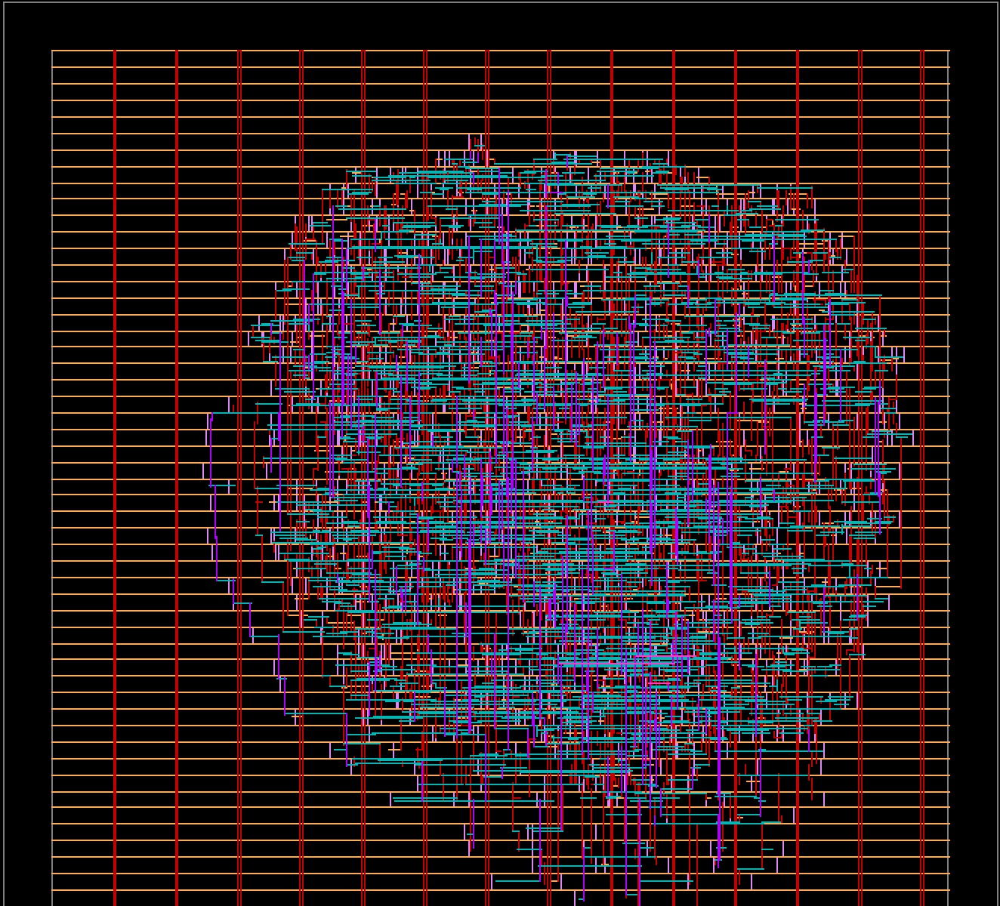


**Figura 11.** Vista general del layout físico capturado en IC Compiler II.

La imagen documenta la implementación física realizada con Synopsys. No representa una validación de equivalencia con el GDSII público de SKY130HD.

### 8.2 GDSII público de SKY130HD

Como entregable público se incluye un archivo GDSII procedente de una implementación anterior realizada mediante OpenROAD y SKY130HD:

[**Ver archivo GDSII de SKY130HD**](deliverables/ALUplus_CHAMO_sky130hd.gds)

| Propiedad            | Descripción                                |
| -------------------- | ------------------------------------------ |
| Archivo              | `ALUplus_CHAMO_sky130hd.gds`               |
| Tecnología de origen | SKY130HD                                   |
| Flujo de origen      | OpenROAD                                   |
| Formato              | GDSII                                      |
| Tamaño               | 3,445,556 bytes                            |
| Procedencia          | Repositorio público original de ALU+ CHAMO |

**Distinción importante:** el GDSII de SKY130HD es un artefacto de una implementación diferente. No es la exportación GDSII producida por Synopsys ICC2 y no se utiliza como prueba de correspondencia física con la netlist Synopsys de este repositorio.

Los archivos GDSII deben inspeccionarse mediante un visor de layout compatible, como KLayout, y no mediante el editor de texto de VS Code.

---

## 9. Resultados y alcance de las verificaciones

### 9.1 Verificación funcional

El proyecto contiene pruebas dirigidas, pseudoaleatorias y exhaustivas de ocho bits.

Las pruebas abarcan:

- Suma, resta y banderas.
- División y residuo.
- División entre cero.
- Selección de operaciones lógicas.
- Comportamiento síncrono.
- Reset.
- Alta impedancia y conflictos de buses triestado.

Los casos programados representan cobertura de estímulos definida en el código. Para afirmar una regresión completamente satisfactoria debe conservarse el registro de ejecución correspondiente.

### 9.2 Verificación física

| Comprobación                  | Estado documentado                     |
| ----------------------------- | -------------------------------------- |
| Placement                     | Etapa completada                       |
| CTS                           | Etapa completada                       |
| Routing                       | Etapa completada                       |
| Celdas sin colocar            | 0                                      |
| Conectividad PG               | Sin celdas flotantes reportadas        |
| Revisión detallada de routing | Pendiente                              |
| PG DRC                        | Resultado final no confirmado          |
| DRC completo                  | No acreditado                          |
| LVS completo                  | No acreditado                          |
| STA multicorner               | No acreditado                          |
| GDSII Synopsys                | Exportación preliminar, no distribuida |

La ejecución exitosa de una herramienta no significa que se hayan satisfecho automáticamente todos los criterios de signoff.

Para declarar un diseño apto para fabricación también deben evaluarse el cumplimiento geométrico, la equivalencia eléctrica y las condiciones temporales y eléctricas requeridas.

### 9.3 Consideraciones de timing

Las etapas de síntesis, CTS y routing permiten estudiar cómo las conexiones físicas y el árbol de reloj influyen en el comportamiento temporal.

El divisor combinacional constituye un bloque de especial interés porque sus iteraciones sucesivas pueden contribuir a la longitud de la trayectoria crítica.

No se publican cifras específicas de frecuencia máxima, slack o área tecnológica de la implementación Synopsys sin contar con un resumen validado y autorizado de los reportes.

---

## 10. Herramientas utilizadas

| Etapa                              | Herramienta                                       |
| ---------------------------------- | ------------------------------------------------- |
| Descripción hardware               | SystemVerilog                                     |
| Verificación funcional             | Testbenches SystemVerilog                         |
| Simulación y análisis de señales   | Simuladores HDL y visualización de formas de onda |
| Síntesis lógica                    | Synopsys Design Compiler                          |
| Implementación física              | Synopsys IC Compiler II                           |
| Floorplan y alimentación           | Synopsys ICC2                                     |
| Placement                          | Synopsys ICC2                                     |
| Clock Tree Synthesis               | Synopsys ICC2                                     |
| Routing                            | Synopsys ICC2                                     |
| Implementación pública alternativa | OpenROAD / SKY130HD                               |
| Inspección de GDSII                | KLayout                                           |
| Desarrollo y documentación         | Visual Studio Code, Markdown y GitHub             |

El repositorio publica la arquitectura funcional y los resultados generales del proyecto, sin distribuir bibliotecas tecnológicas ni archivos de configuración de fabricación de acceso restringido.

---

## 11. Organización del repositorio

```text
ALUChamo/
│
├── README.md
│
├── rtl/
│   ├── alu_cla.sv
│   ├── alu_core.sv
│   ├── alu_divider.sv
│   ├── alu_logic_tristate.sv
│   ├── alu_sync16.sv
│   └── alu_tristate_demo.sv
│
├── tb/
│   ├── tb_alu_arithmetic.sv
│   ├── tb_alu_core.sv
│   ├── tb_alu_sync16.sv
│   ├── tb_alu_tristate.sv
│   ├── tb_exhaustive8.sv
│   └── tb_logic_tristate.sv
│
├── docs/
│   ├── verification_summary.md
│   └── screenshots/
│       ├── 01_simulation/
│       │   ├── div_mod_waveform.png
│       │   └── tristate_waveform.png
│       ├── 03_floorplan/
│       │   └── Floorplan.jpeg
│       ├── 05_placement/
│       │   └── Placement.jpeg
│       ├── 06_cts/
│       │   └── cts.png
│       ├── 07_routing/
│       │   └── Routing.jpeg
│       └── 08_gds_drc_lvs/
│           └── GDS.jpeg
│
└── deliverables/
    └── ALUplus_CHAMO_sky130hd.gds
```

---

## 12. Principales aprendizajes

### Arquitectura y lógica digital

El desarrollo del proyecto permitió implementar un circuito aritmético modular, empleando un CLA para suma/resta y una unidad de división combinacional independiente.

La organización por módulos facilita probar operaciones individualmente y después integrarlas en un sistema síncrono.

### Verificación

La combinación de pruebas dirigidas, aleatorias y exhaustivas permite evaluar casos normales y situaciones límite, como overflow, división entre cero y transiciones de control.

### Implementación física

El flujo ASIC demuestra que una descripción RTL no constituye directamente un layout físico.

Después de sintetizar la lógica es necesario colocar las celdas, distribuir la alimentación, construir el reloj e implementar las conexiones metálicas.

### Integridad de alimentación

La experiencia de implementación también demuestra la importancia de comprobar la conectividad de las redes de alimentación y verificar los checkpoints guardados después de cada modificación significativa.

### Limitaciones de la implementación

La generación de un layout y la ejecución de routing no garantizan, por sí solas, que el diseño esté preparado para fabricación. La revisión de DRC, LVS, timing y condiciones eléctricas es una parte esencial del proceso.

---

## 13. Conclusión

**ALU+ CHAMO** permitió integrar conocimientos de arquitectura digital, descripción de hardware, verificación funcional y diseño físico de circuitos integrados.

El proyecto comenzó con módulos SystemVerilog para desarrollar un sumador Carry-Lookahead, un divisor combinacional y las operaciones principales de una ALU. Posteriormente, la lógica se integró en una interfaz síncrona de 16 bits y se organizaron testbenches para evaluar su comportamiento.

Mediante las herramientas Synopsys se ejecutaron las principales etapas de implementación física, incluyendo síntesis, placement, construcción del árbol de reloj y routing. El estado final documentado contiene **943 instancias colocadas**, sin celdas estándar flotantes de alimentación reportadas.

Como referencia pública adicional se incluye el GDSII previamente generado mediante OpenROAD y SKY130HD, manteniéndolo claramente separado de la implementación Synopsys.

El trabajo muestra cómo una arquitectura digital evoluciona desde sus ecuaciones y módulos RTL hasta una representación física, y destaca la importancia de distinguir entre **simulación funcional, implementación completada y validación final de fabricación**.

---

## 14. Referencia del proyecto original

La implementación pública anterior de ALU+ CHAMO, desarrollada con OpenROAD y SKY130HD, se encuentra en:

[ALU+ CHAMO — Repositorio original](https://github.com/Josemedinan/ALUplus_Chamo)

El presente proyecto documenta adicionalmente el desarrollo RTL y el flujo de implementación realizado mediante Synopsys, sin publicar archivos tecnológicos de acceso restringido.
